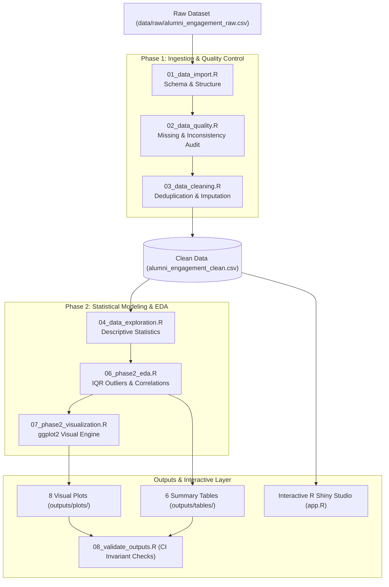
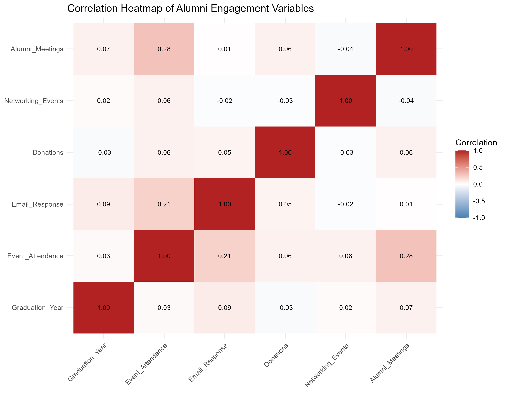
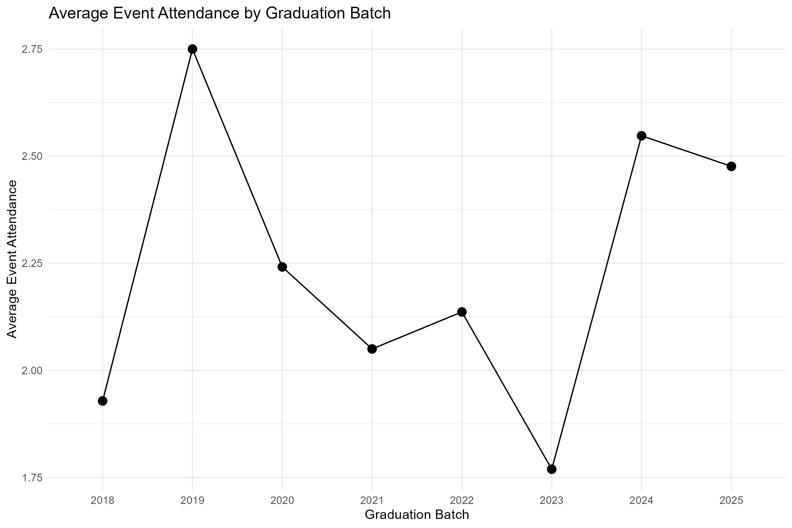
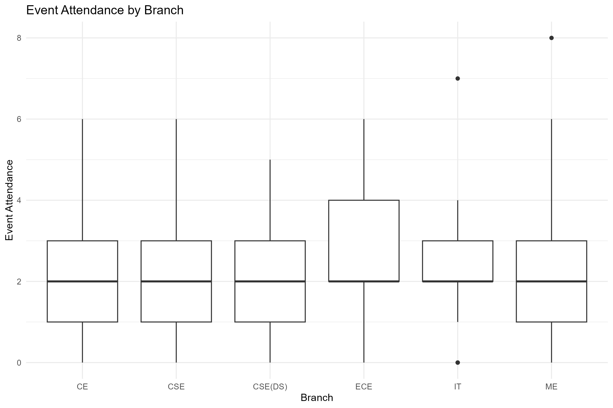
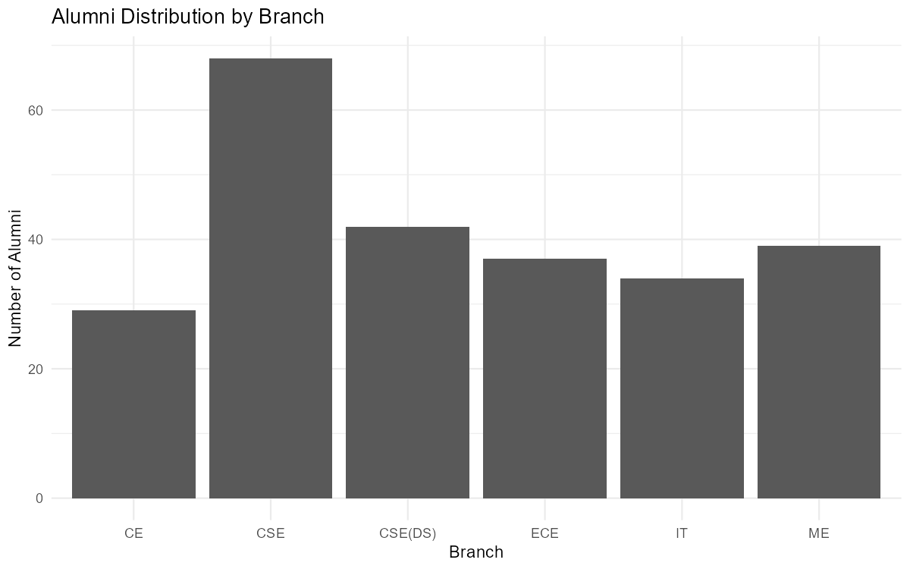

# Alumni Engagement Analytics — FODS Studio

[](https://www.r-project.org/)
[](https://shiny.rstudio.com/)
[](https://ggplot2.tidyverse.org/)
[](https://dplyr.tidyverse.org/)
[](https://sdgs.un.org/goals/goal4)
[](.github/workflows/r-validation.yml)

An analytical data science studio and reproducible R workflow developed for the **Foundations of Data Science (CCSDS0301)** Project-Based Learning (PBL) curriculum. It provides data cleaning, statistical correlation, IQR outlier detection, exploratory visualization, and an interactive **R Shiny** analytical dashboard for educational institutions.

---

## 🔬 Data Pipeline Architecture



---

## 📊 Visual Analytics Gallery

Here are highlights from the 8 generated exploratory data visualizations:

| Correlation Heatmap | Batch Attendance Trends |
| :---: | :---: |
|  |  |

| Event Attendance by Department | Alumni Count by Branch |
| :---: | :---: |
|  |  |

---

## 💻 Interactive Shiny Analytics Studio

The repository includes a full interactive Shiny web application in `app.R`:
* **Overview KPI Metrics**: Total alumni, active participation rate, and batch-level engagement breakdown.
* **Filterable Data Explorer**: Searchable records with CSV export capabilities.
* **Cohort Comparisons**: Group-level comparisons across branch, graduation batch, and mentorship enrollment.
* **Correlation Lab**: Interactive scatterplots and relationship matrices.
* **Visualization Lab**: On-the-fly customizable histograms, boxplots, and violin distributions.

### Launch the App Locally

Open RStudio or an R terminal in the repository root directory:

```r
# 1. Install dependencies
install.packages(c("shiny", "readr", "dplyr", "tidyr", "ggplot2"))

# 2. Launch the Shiny Studio
shiny::runApp("app.R")
```

---

## ⚡ Reproducible Analysis Pipeline

To execute the entire analytical pipeline from scratch, run the scripts in sequence:

```r
source("R/01_data_import.R")       # Step 1: Validate raw schema
source("R/02_data_quality.R")      # Step 2: Run missingness audit
source("R/03_data_cleaning.R")     # Step 3: Produce clean dataset
source("R/04_data_exploration.R")  # Step 4: Compute summary stats
source("R/05_basic_visualization.R")# Step 5: Generate initial plots
source("R/06_phase2_eda.R")        # Step 6: IQR outlier detection & matrix
source("R/07_phase2_visualization.R")# Step 7: Export high-res plots
source("R/08_validate_outputs.R")  # Step 8: Assert output integrity
```

---

## 📁 Repository Structure

```text
Alumini-Engagement-Analytics-FODS-/
├── app.R                          # Interactive Shiny analytics application
├── R/                             # Sequential 8-stage data pipeline scripts
│   ├── 01_data_import.R
│   ├── 02_data_quality.R
│   ├── 03_data_cleaning.R
│   ├── 04_data_exploration.R
│   ├── 05_basic_visualization.R
│   ├── 06_phase2_eda.R
│   ├── 07_phase2_visualization.R
│   └── 08_validate_outputs.R
├── data/
│   ├── raw/alumni_engagement_raw.csv
│   └── processed/alumni_engagement_clean.csv
├── outputs/
│   ├── plots/                     # 8 high-resolution PNG charts
│   └── tables/                    # 6 statistical summary CSV tables
├── docs/                          # Course documentation & phase checkpoints
│   ├── FODS_SYLLABUS_ALIGNMENT.md
│   ├── PHASE_2.md
│   ├── PHASE_2_CHECKPOINT.md
│   └── RESEARCH_NOTES.md
├── .github/workflows/
│   └── r-validation.yml           # Automated CI verification workflow
└── README.md
```

---

## 📜 Dataset & Academic Note
* **Course:** Foundations of Data Science (`CCSDS0301`).
* **Ethical Disclosure:** The project uses synthetic data to illustrate educational analytics techniques while strictly maintaining privacy. Results represent simulated exploratory analysis.
